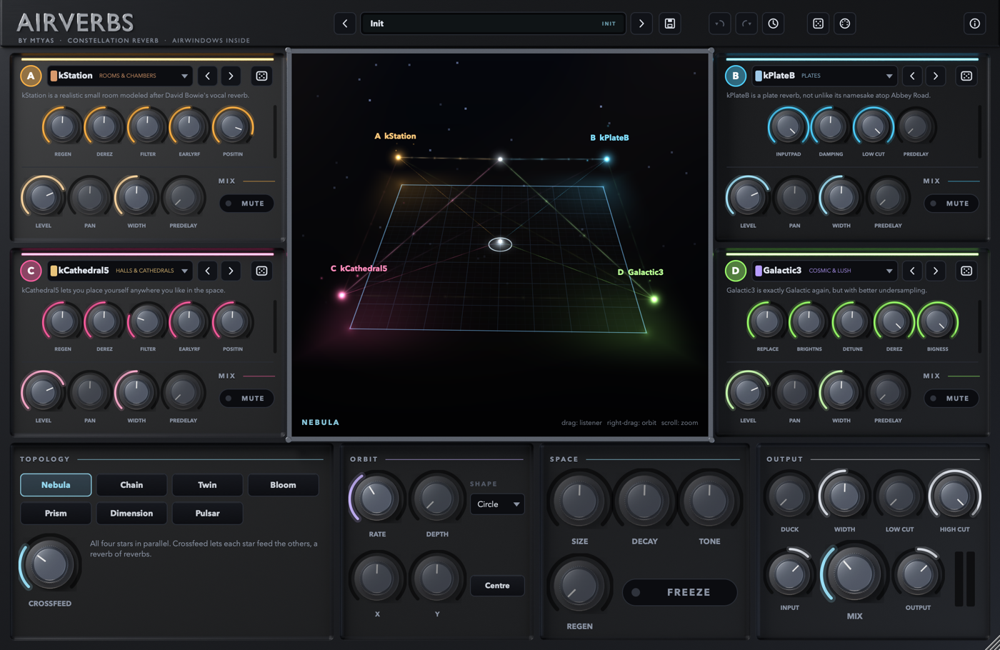

# Airverbs — a constellation of Airwindows reverbs

**by mtyas · v0.77 · public domain (The Unlicense)**



**Download:** grab the zip for your system from the [Releases](../../releases) page
(macOS universal: VST3 / AU / CLAP / Standalone · Windows x64: VST3 / CLAP / Standalone ·
Linux x64: VST3 / CLAP / LV2 / Standalone). Each zip has an `INSTALL.txt`.

Airverbs hosts **all 53 Airwindows reverbs** (kCathedral 1–5, kPlate A–D/140/240, kBeyond, kCosmos,
kRockstar 1–2, kGuitarHall 1–2, kStation, kWoodRoom, kCyberCity, kAlienSpaceship, kChamberAR,
VerbSevens, VerbSixes, VerbTiny, VerbThic, Galactic 1–3, Infinity 1–2, MatrixVerb, NonlinearSpace,
Chamber 1–2, Verbity 1–2, PocketVerbs, Reverb, Ultralight 1–2, MV, MV2, StarChild 1–2, Melt,
ClearCoat, CloudCoat, CreamCoat, CrunchCoat, BrightAmbience 1–3). They are compiled **unmodified**
from Chris Johnson's sources, then wired together in new ways.

Formats: **VST3, CLAP, AU** (macOS), **LV2** (Linux) and a **Standalone** app on macOS, Windows and Linux.

## The idea: four stars, one listener

* **Four stars (A–D).** Each one runs any Airwindows reverb. Its native controls (Regen, Derez,
  Bigness...) appear on the star's panel and relabel themselves for each algorithm. Each star also
  has level, pan, width, mute and up to 500 ms of pre-delay. Switching algorithm crossfades without
  clicks: engines are built on a background thread, and the audio thread never allocates.
* **Seven topologies** decide how the stars are connected:
  | Topology | What it does | Morph knob |
  |---|---|---|
  | **Nebula** | All four in parallel, each star feeding the others: a reverb of reverbs | Crossfeed |
  | **Chain** | A→B→C→D; the vector pad picks how deep into the cascade you listen | Thru (dry carried along) |
  | **Twin** | (A→B) ‖ (C→D) | L/R split between the chains |
  | **Bloom** | A builds the early field and seeds B, C and D | Seed (dry into B/C/D) |
  | **Prism** | 4-band Linkwitz-Riley split: lows→A … highs→D | Crossover position |
  | **Dimension** | Mid→A+B, Side→C+D, whose returns land only in the sides | Side gain |
  | **Pulsar** | Transient detector: attacks→A+B, sustain→C+D | Sensitivity |
* **The listener (vector pad).** The 3D floor is an equal-power vector mixer between the four
  stars, like vector synthesis applied to reverb spaces. Drag the puck, or let it **orbit**
  (circle, figure 8, Lissajous, random drift, pendulum) to get spaces that move.
* **Macros.** *Size*, *Decay* and *Tone* push every star's matching native controls up or down
  together, whatever the algorithm. Each engine's parameters are tagged by role.
* **Regen + Freeze.** An outer feedback loop sends the whole constellation's output back into
  itself, with an energy governor so it blooms instead of exploding. **Freeze** mutes the input
  and holds the current sound indefinitely at constant loudness.
* **Duck, Width, 24 dB/oct Low/High Cut, equal-power Mix, Input/Output.**
* **Engine loudness is normalised.** Each engine gets a measured trim (see
  `tools/engine_trims.json`), so swapping algorithms doesn't jump in level.

## Workflow features

* **MIDI learn:** right-click any knob or switch, then choose *MIDI Learn* and move a controller.
  Mapped controls show a dot. The MIDI button lists every mapping and can clear them. Mappings are
  saved with the session.
* **Preset browser:** search across names, categories, notes and engine names. Includes
  categories, favourites, click-to-audition, Save As (name, category and notes), rename, delete
  (to trash), import, export and reveal folder. There are 41 factory presets in 8 categories.
  User presets are plain XML `.airverb` files:
  * macOS `~/Library/Audio/Presets/Airverbs`
  * Windows `%APPDATA%\Airverbs\Presets`
  * Linux `~/.config/Airverbs/Presets`

  Sub-folders become categories. ←/→ step through presets.
* **Undo / redo** of everything, including engine swaps and preset loads. Each knob drag, engine
  change or preset load is one labelled step. Use the buttons, the **history menu** (jump to any
  step), or Cmd/Ctrl+Z and Cmd/Ctrl+Shift+Z. Cmd/Ctrl+S saves.
* Randomise the whole constellation or a single star. Shift-drag for fine control, double-click
  to reset. The window is resizable (840–1800 px wide).

## The 3D GUI

* `assets/blender/render_knob.py` renders the knob in Blender Cycles: knurled aluminium with a
  concentric-brushed cap and engraved indicator, 64 frames → `assets/rendered/knob.png`.
* `assets/blender/render_chassis.py` renders the machined chassis, with recessed bays, star LED
  strips, the chrome bezel and the raised logo. It is laid out from `assets/layout.json`, the same
  file the C++ GUI reads, so the controls line up with the render.
* The centre "observatory" is real-time **OpenGL 3.2**. It shows a starfield sky, the vector
  floor lit by each star's live energy (with ripples), topology beams with photons travelling
  along them, tethers from the listener to each star (brightness = mix weight), the orbit path,
  and a particle system emitted at each star's output energy. Particles hang crystallised while
  frozen.

Re-render the assets (optional, the PNGs are committed):
```
/Applications/Blender.app/Contents/MacOS/Blender -b --python assets/blender/render_knob.py -- 64 144
/Applications/Blender.app/Contents/MacOS/Blender -b --python assets/blender/render_chassis.py -- 2 128
```

## Building

Releases are built by GitHub Actions (`.github/workflows/build.yml`): every push builds and
tests macOS, Windows and Linux, and pushing a version tag publishes a Release with the zips:
```
git tag v0.77 && git push origin v0.77
```

Requirements to build locally: CMake ≥ 3.22, a C++20 compiler (Xcode CLT / MSVC 2022 / GCC 11+), git.
Linux also needs: `libasound2-dev libx11-dev libxext-dev libxrandr-dev libxinerama-dev libxcursor-dev libfreetype6-dev libfontconfig1-dev libgl1-mesa-dev`.

```
./tools/fetch_deps.sh
cmake -S . -B build -DCMAKE_BUILD_TYPE=Release
cmake --build build --config Release --target Airverbs_All Airverbs_CLAP
```
Plugins land in `build/Airverbs_artefacts/Release/{VST3,AU,CLAP,LV2,Standalone}`.
On Windows, run `tools/fetch_deps.sh` from Git Bash. `.github/workflows/build.yml` builds and
tests all three platforms on GitHub Actions (add `-DCMAKE_OSX_ARCHITECTURES="arm64;x86_64"` for
universal macOS binaries).

### Tests
```
build/tests/AirverbsTests survey      # every engine: loudness, T30, CPU, NaN check
build/tests/AirverbsTests network     # topologies, regen, freeze, hot-swap, sample rates
build/tests/AirverbsPluginTests       # all presets, state round trip, MIDI learn, undo/redo, user presets
```
`AIRVERBS_SNAPSHOT=/tmp/gui.png <standalone binary>` (add `AIRVERBS_SNAPSHOT_BROWSER=1` to include the preset browser) renders the whole GUI (including the GL scene) to a PNG.

## Source map
```
source/airwindows/shim/audioeffectx.h  minimal VST2 base class so Airwindows compiles unmodified
source/airwindows/engines/aw_*.cpp     generated: each engine wrapped in its own namespace
source/airwindows/EngineInfo.inc       generated: params, roles, display labels, trims, descriptions
source/dsp/EngineSlot.*                one star: lock-free hot-swap + crossfade, pre-delay, width/pan/level
source/dsp/Constellation.*             topologies, vector/orbit, regen/freeze loop, output stage
source/state/                          parameters, MIDI learn, snapshot undo history
source/presets/                        preset manager + factory presets
source/gui/                            look & feel, filmstrip knobs, star panels, OpenGL view, browser
tools/                                 generators (engines, metadata) + dependency fetcher
```
Regenerate after updating Airwindows: `python3 tools/gen_engines.py`, then rebuild
`tools/dump_params.cpp` to refresh `tools/engine_params.json`, run `python3 tools/gen_engine_info.py`,
and re-run `AirverbsTests survey tools/engine_trims.json` to refresh the trims.

## Licence
Airverbs itself is released into the **public domain** under [The Unlicense](LICENSE): do
anything you like with it, no attribution required.

It builds on third-party code that keeps its own licence (none of it is stored in this repo;
`tools/fetch_deps.sh` downloads it):
* **Airwindows** reverbs, MIT © Chris Johnson. Please support him at patreon.com/airwindows.
* **JUCE 9**, AGPLv3 or commercial. Compiled binaries include JUCE, so anyone *distributing
  binaries* must follow JUCE's terms; with the AGPLv3 that means publishing the full source,
  which this repository does.
* **clap-juce-extensions / CLAP**, MIT.

Details are in `THIRD_PARTY_NOTICES.md`.
